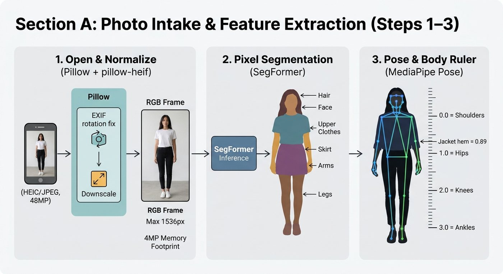
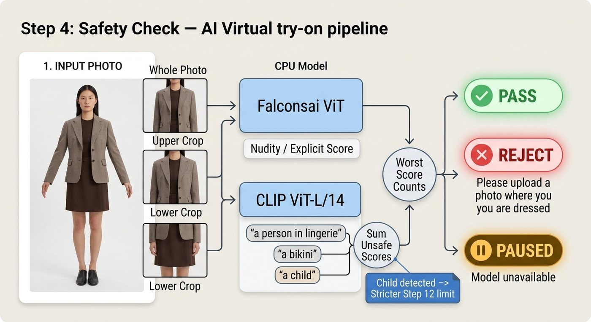
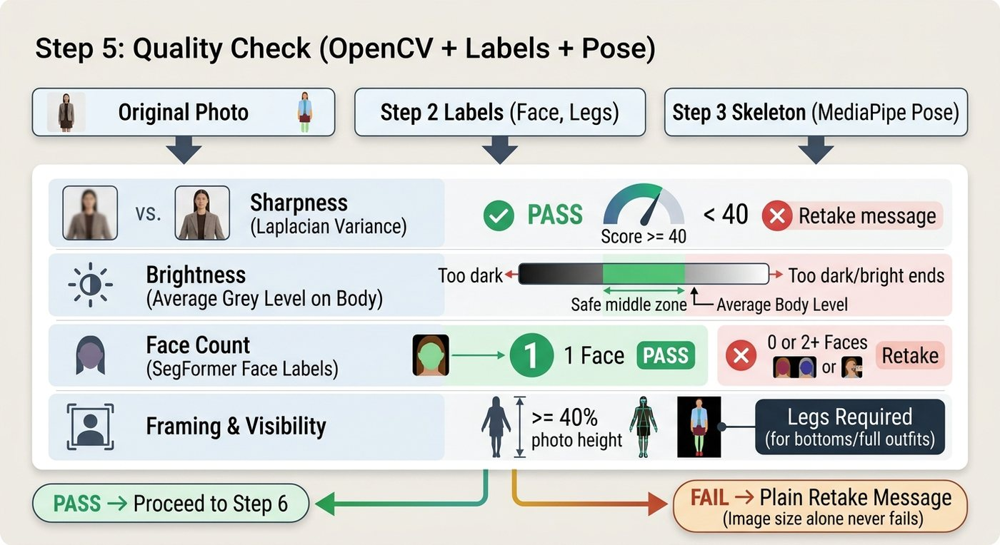
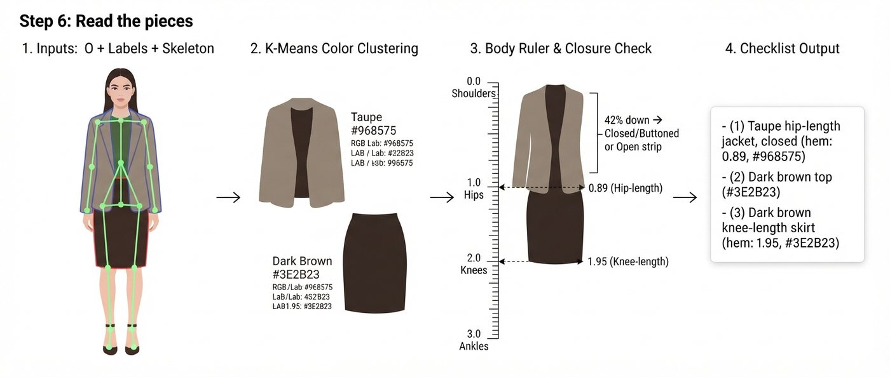
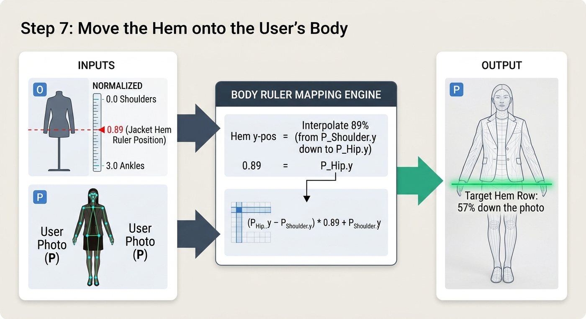
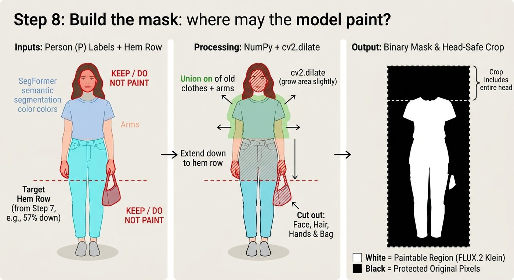
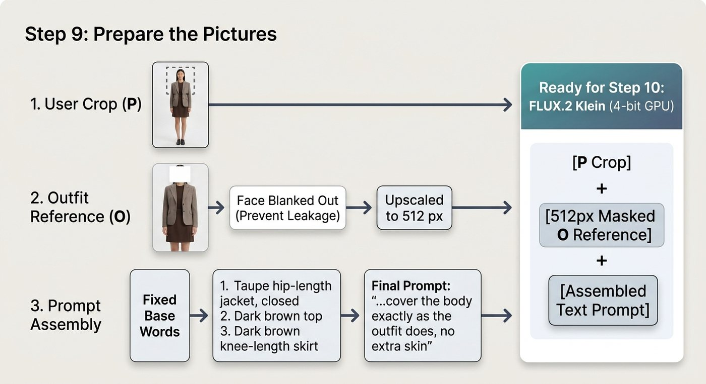
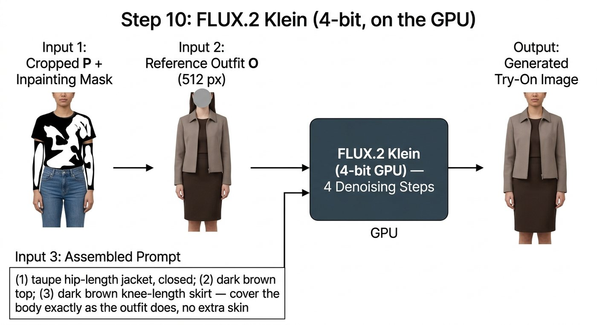
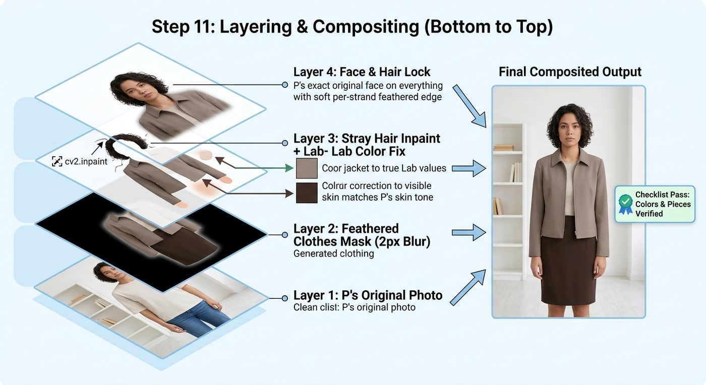
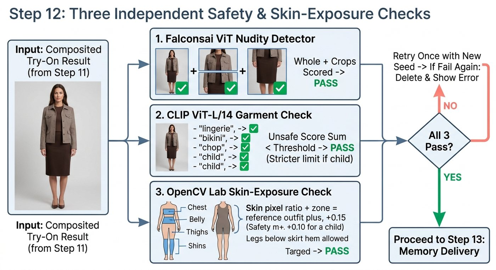

<div align="center">

# 🪞 Try-On Studio

**Step into the mirror. Pick an outfit. The curtains open on you wearing it.**

A self-hosted virtual try-on: upload a photo (or use your camera), add one or more outfit photos,
and see yourself in them — your own face, pose and background, with the clothes changed and
nothing else.

**[▶ Open the live site](https://nardy11.github.io/tryon-studio/)** ·
[How it works](#-how-it-works-step-by-step) ·
[Safety & privacy](#-safety--privacy) ·
[Run it yourself](#-run-it-yourself)


</div>

---

## ✨ What it does

- 🎭 **A stage, not a form.** Red curtains close while your look is made, then lift and part to reveal it. Pull the gold rope to compare with your own photo.
- 👗 **Several outfits at once.** They're made one after another, and you flip through them with **Next** or **a swipe of your hand** (hand tracking runs in your browser).
- 📷 **Photo or Live camera.** Upload photos, or stand in front of the camera: one picture is taken once, then the outfit **stays on you while you move**.
- 🧵 **Reads the outfit like a stylist.** Jacket, top underneath, trousers; each piece's colour; where each hem ends on the body. That checklist goes to the model, and every result is checked against it.
- 🛡️ **Safe by design.** Every photo and every result is checked. Nothing revealing is ever made or shown, and photos are never stored.
- 🖥️ **Your GPU, no API bill.** The model runs on your own machine. No tokens, no per-image fees, no photos sent to anyone.

---

## 🧭 How it works, step by step

> P = your photo · O = the outfit photo

### 1–3 · Intake: open, segment, measure

The photo is decoded (any size, HEIC included), every pixel is labelled (face, hair, upper
clothes, skirt, arms, legs…), and **MediaPipe Pose** gives a *body ruler*: 0 = shoulders, 1 = hips,
2 = knees, 3 = ankles.



### 4 · Safety check (before anything runs)

Two local models on the CPU: a **nudity classifier** and **CLIP**, which scores phrases like
"a person in lingerie". The worst of three crops counts. If a check can't run, nothing runs.



### 5 · Quality check: is the photo clear enough?

Sharpness, light, one face, framing, legs when needed. A poor photo gets a friendly "please
upload another one", **before** any GPU time is spent. Size alone never refuses a photo.



### 6 · Read the pieces

Colours are clustered in Lab space and grouped into garments (light and shadow of one fabric stay
one garment). Each hem is measured on the body ruler: *"taupe hip-length jacket, closed; dark
brown top; dark brown knee-length skirt"*.



### 7 · Move the hem onto your body

A jacket that ends at 0.89 on the model's ruler ends at 0.89 on yours: the same body point, so it
fits your proportions instead of the model's.



### 8 · Build the mask: where may the model paint?

Old clothes and arms, grown slightly and extended to the new hem. Face, hair, hands and anything
you hold are protected. The crop always includes your whole head.



### 9 · Prepare the pictures

Your crop, the outfit's real pixels (with the model's face blanked out), and a prompt built only
from fixed words and the checklist. No free text ever reaches the model.



### 10 · FLUX.2 Klein on the GPU

FLUX.2 Klein 4B (4-bit, 4 steps, about 15–25 s on a laptop RTX 4060) draws you in the outfit.



### 11 · Layer it back onto your photo

Bottom to top: your original photo, then the model's pixels inside the clothes area only, then stray
hair removed, colours matched to the outfit and to your skin, and finally **your own face and hair
pasted back, pixel for pixel**.



### 12 · Three independent checks before you see it

A nudity detector, a CLIP garment check, and a **skin-coverage check per body region** compared
with the outfit photo. Skin may show only where the outfit shows it. Fail → one more try with a new
seed → still failing → *"We couldn't make this look properly."*



### 13 · Delivery

The result can be downloaded **once**, then it's deleted from the server. If nobody collects it,
it's gone after 2 minutes.

---

## 🏗️ Architecture

```
  Phone / laptop browser                         Your laptop (NVIDIA GPU)
 ┌──────────────────────────┐   https tunnel   ┌───────────────────────────────────┐
 │ GitHub Pages             │ ───────────────► │ FastAPI  ·  one GPU worker         │
 │ React + Vite             │                  │  ├─ safety + quality (CPU)         │
 │  ├─ curtains & mirror    │ ◄─────────────── │  ├─ SegFormer · MediaPipe Pose     │
 │  ├─ hand gestures (MP)   │   result, once   │  ├─ outfit reader (OpenCV)         │
 │  └─ live body tracking   │                  │  └─ FLUX.2 Klein 4B (4-bit)        │
 └──────────────────────────┘                  └───────────────────────────────────┘
```

- **Website:** `web/`, published on **GitHub Pages** (`bash web/deploy-pages.sh`). https, so phone cameras work.
- **Server:** `server/`, runs on the machine with the GPU and is reached through a **Cloudflare tunnel**. The site asks for the server's address, or you share a link with `?server=https://…` and it's remembered.

---

## 🛡️ Safety & privacy

| | |
|---|---|
| **Photos in** | Dressed people only. Nudity, underwear, swimwear and see-through clothes are refused. Children's photos are allowed, and their results are checked more strictly. |
| **Results out** | Three independent checks. The outfit's own coverage is the rule: never more skin than the outfit shows. |
| **Nothing stored** | No database, no disk, no bucket. Photos live in memory while the look is made. The result is downloadable once. |
| **No free text** | The prompt is built by the server from what it reads in the photos. |
| **Fair use** | A limit of looks per visitor per 10 minutes. One GPU, shared fairly. |
| **Fails closed** | If a safety model can't run, try-on pauses. Nothing is generated unchecked. |

Details: [docs/SAFETY.md](docs/SAFETY.md) · Full walkthrough: [docs/how-the-tryon-works.md](docs/how-the-tryon-works.md)

---

## 🚀 Run it yourself

**Needs:** Windows or Linux, Python 3.11, Node 20+, pnpm, an NVIDIA GPU with 8 GB+ VRAM, about 25 GB of disk for the models.

```powershell
# 1. Server environment
py -3.11 -m venv server\.venv
server\.venv\Scripts\python -m pip install torch torchvision --index-url https://download.pytorch.org/whl/cu128
server\.venv\Scripts\python -m pip install -r server\requirements.txt
server\.venv\Scripts\python -m pip install --no-deps mediapipe==1.2.2 absl-py flatbuffers

# 2. Models (Klein, parser, safety models, pose; cached locally)
server\.venv\Scripts\python server\scripts\download_models.py

# 3. Start the server (GPU)            4. Start the website
.\server\run.ps1                        cd web; pnpm install; pnpm dev
```

Open **https://localhost:5175**. Accept the local certificate once; it's what lets the camera work.

### Share it from your laptop

```powershell
cloudflared tunnel --url http://localhost:8000
```

Copy the `https://….trycloudflare.com` address it prints, then share
`https://nardy11.github.io/tryon-studio/?server=<that address>`. Visitors use your GPU while the
laptop is on and the tunnel is running.

### Settings

| Variable | Default | Meaning |
|---|---|---|
| `TRYON_MAX_SIDE` | `1024` | Longest side sent to the model (768 = faster) |
| `TRYON_KLEIN_4BIT` | `1` | 4-bit Klein for 8 GB GPUs; `0` on 24 GB+ |
| `TRYON_RESULT_TTL_S` | `120` | Seconds an uncollected result is kept in memory |
| `TRYON_LOOKS_PER_10MIN` | `12` | Looks one visitor may start per 10 minutes |
| `TRYON_MAX_QUEUE` | `20` | Jobs allowed to wait before new ones get HTTP 429 |
| `TRYON_CORS_ORIGINS` | localhost + `nardy11.github.io` | Sites allowed to call the server |
| `TRYON_DEBUG_DIR` | *(unset)* | Developer machines only: writes every photo to disk for tuning |

---

## 📜 Licences

- **FLUX.2 Klein 4B**: Apache 2.0. The 9B variant is non-commercial; don't swap it in.
- **MediaPipe**: Apache 2.0 · **Falconsai NSFW detector**: Apache 2.0 · **CLIP**: MIT.
- **SegFormer clothes parser** (`mattmdjaga/segformer_b2_clothes`): licence listed as "other" on the Hub. Check it before commercial use.
- CatVTON was used only to evaluate quality during development. It is not part of this repository.

<div align="center">

Made with 🧵 by [Nardy11](https://github.com/Nardy11)

</div>
